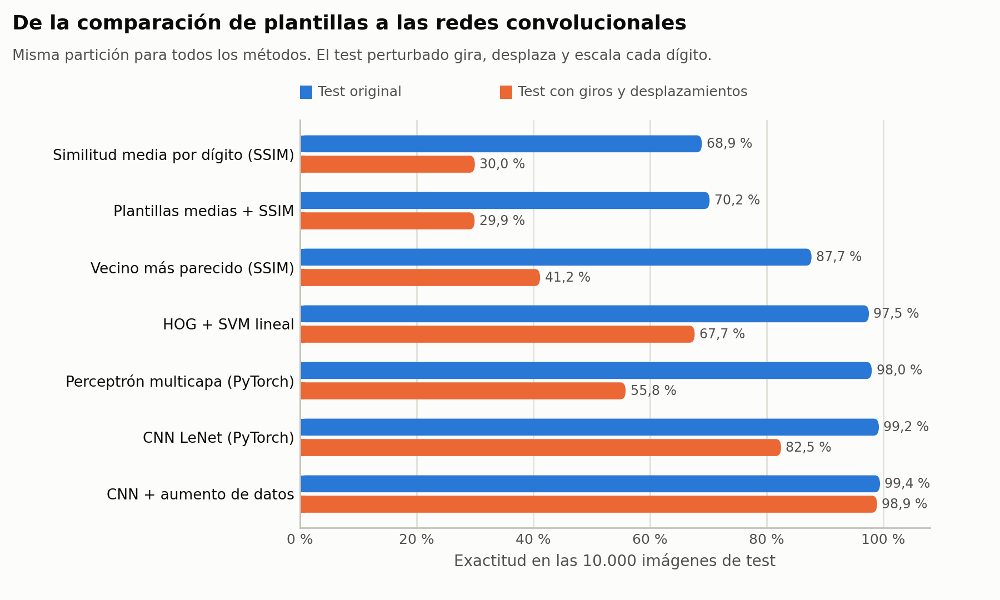
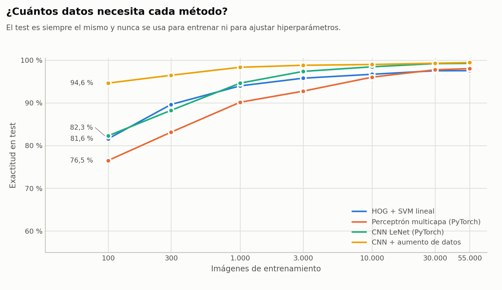
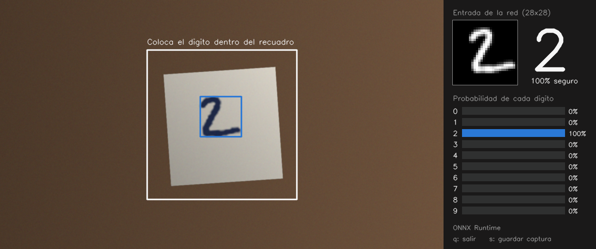
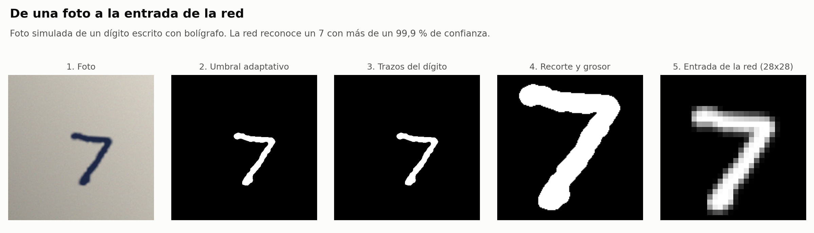
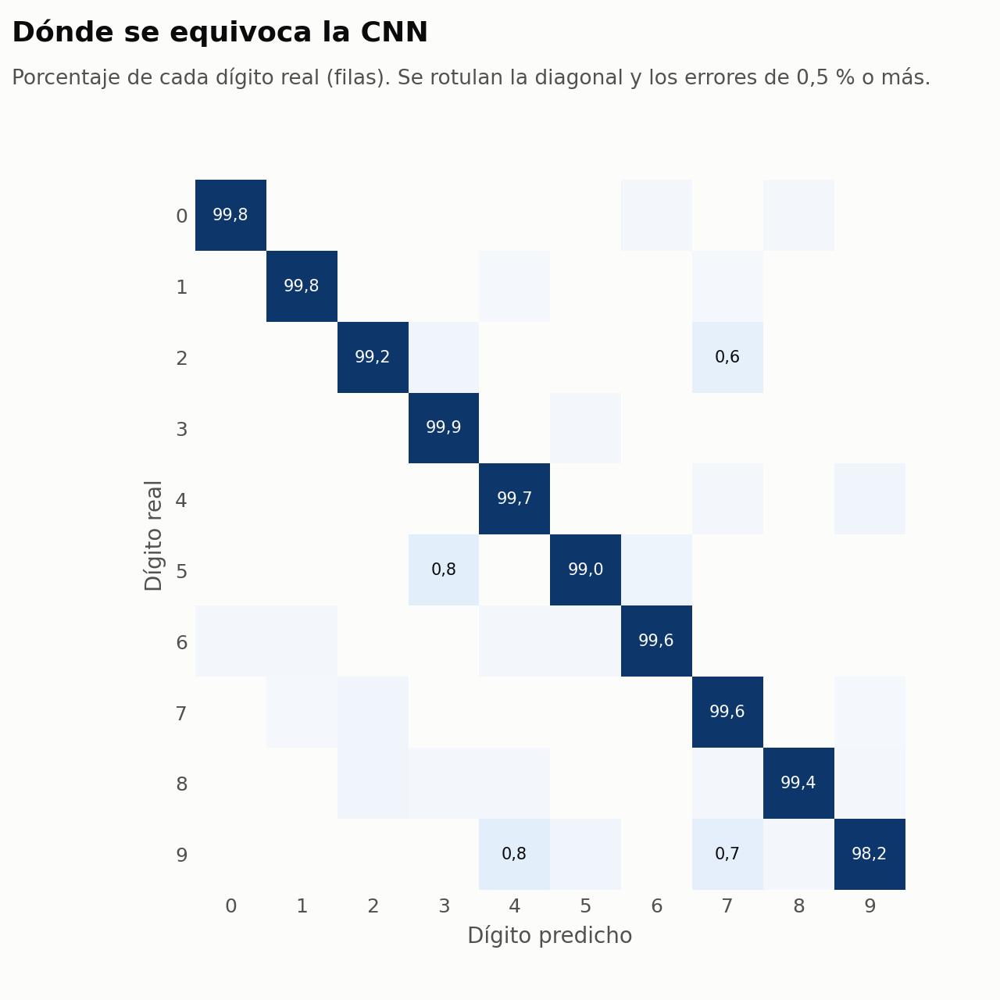
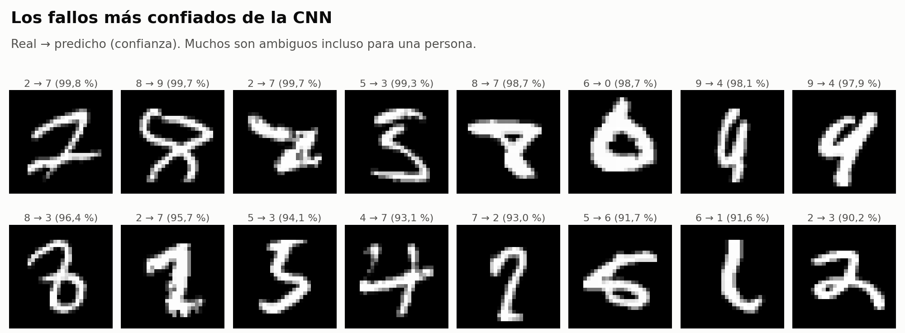
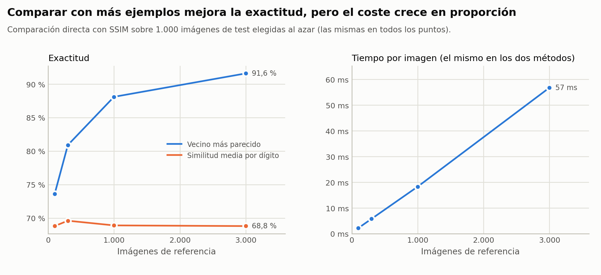
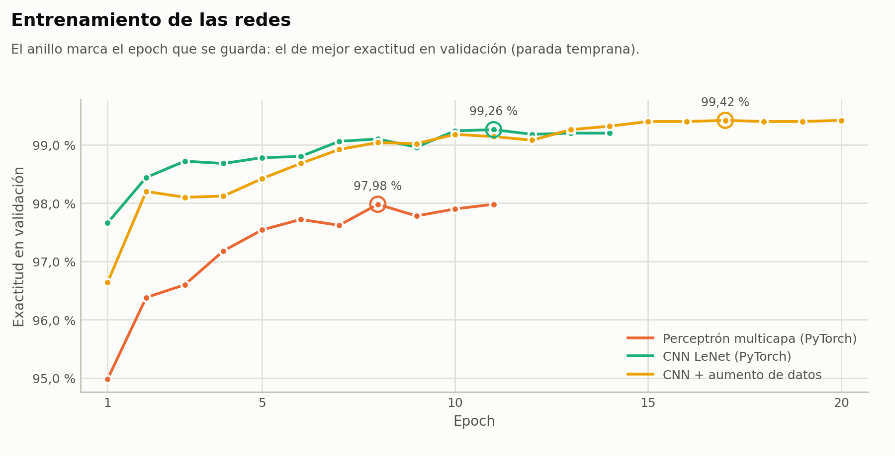
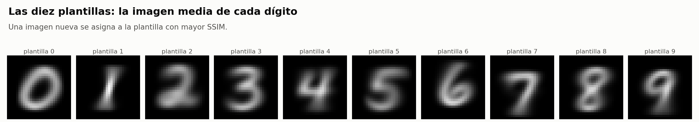
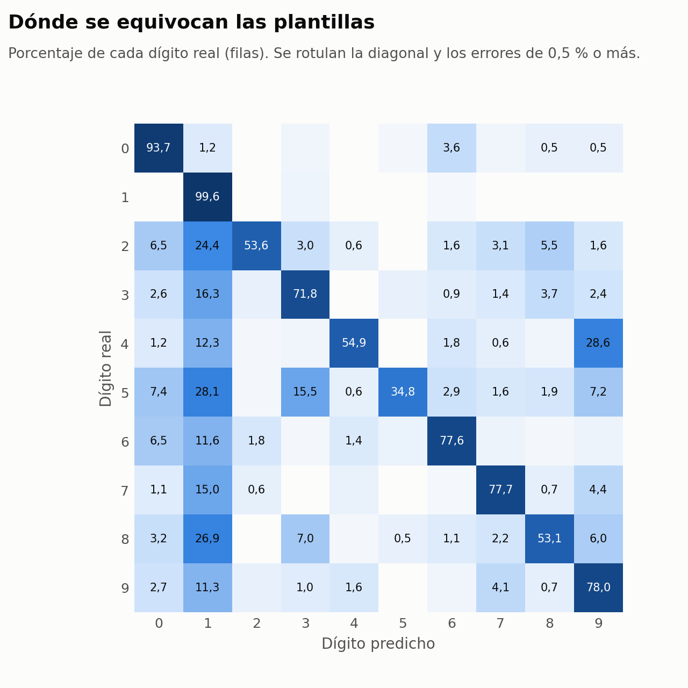

# Reconocimiento de dígitos manuscritos: de las plantillas a las redes convolucionales

[](https://github.com/AngelorumCSE/reconocimiento-digitos-manuscritos/actions/workflows/pruebas.yml)

Comparativa de siete métodos para reconocer dígitos escritos a mano (MNIST), desde la comparación con plantillas mediante SSIM hasta una red convolucional en PyTorch, todos evaluados con la misma partición y sin fuga de datos. La mejor red (99,4 % de exactitud en test) se exporta a ONNX y reconoce dígitos en tiempo real con la webcam y en una web hecha con Streamlit.

> **English summary.** Seven handwritten-digit classifiers on MNIST (SSIM template matching and nearest neighbour, HOG + linear SVM, an MLP, LeNet and LeNet with data augmentation in PyTorch) compared on the same split with a held-out test set. The augmented CNN reaches 99.4 % test accuracy and keeps 98.9 % on rotated, shifted and rescaled digits, while the same network without augmentation drops to 82.5 %. Includes a real-time webcam demo (OpenCV) with an MNIST-style preprocessing pipeline and a Streamlit app that runs the model with ONNX Runtime.

## Resultados

<picture>
  <source media="(prefers-color-scheme: dark)" srcset="reports/figuras/resultados_oscuro.png">
  
</picture>

| Método | Exactitud (test) | F1 macro | Exactitud con giros y desplazamientos | Entrenamiento | Tiempo por imagen | Parámetros |
|---|---:|---:|---:|---:|---:|---:|
| Similitud media por dígito (SSIM) | 68,9 % | 0,679 | 30,0 % | — | 27,45 ms | — |
| Plantillas medias + SSIM | 70,2 % | 0,701 | 29,9 % | < 1 s | 0,49 ms | — |
| Vecino más parecido (SSIM) | 87,7 % | 0,875 | 41,2 % | — | 27,45 ms | — |
| HOG + SVM lineal | 97,5 % | 0,975 | 67,7 % | 30 s | 0,80 ms | 12.970 |
| Perceptrón multicapa (PyTorch) | 98,0 % | 0,980 | 55,8 % | 11 s | 0,04 ms | 203.530 |
| CNN LeNet (PyTorch) | 99,2 % | 0,992 | 82,5 % | 198 s | 0,79 ms | 1.528.078 |
| CNN + aumento de datos | 99,4 % | 0,994 | 98,9 % | 337 s | 0,77 ms | 1.528.362 |

Exactitud y F1 sobre las 10.000 imágenes del test oficial, que no se usan nunca para entrenar ni para elegir hiperparámetros. El test perturbado aplica a cada dígito un giro de hasta ±25°, un desplazamiento de hasta ±3 píxeles y un cambio de escala de 0,8 a 1,2. Tiempos medidos en una CPU de 2 núcleos, clasificando de una en una como en la demo.

**Qué enseña la comparativa**

- **Comparar píxeles no basta.** Las plantillas medias se quedan en un 70,2 % (el 48 % de sus errores son imágenes asignadas a la plantilla del 1) y la similitud media por dígito en un 68,9 %. Buscar el ejemplo más parecido sube al 87,7 %, pero con solo 1.000 referencias (100 por dígito) ya tarda 27 ms por imagen, y el coste crece en proporción al número de ejemplos.
- **Unas buenas características cambian el resultado.** Con histogramas de gradientes orientados (HOG), un SVM lineal llega al 97,5 % y se entrena en 30 segundos.
- **Las convoluciones ganan.** La red LeNet alcanza el 99,2 %, frente al 98,0 % del perceptrón multicapa, y clasifica cada imagen en menos de 1 ms.
- **El aumento de datos es lo que la hace útil fuera de MNIST.** Entrenada con giros, desplazamientos, cambios de escala y trazos más gruesos, la misma red mantiene un 98,9 % en el test perturbado, frente al 82,5 % sin aumento. Además aprovecha mejor pocos datos: con solo 100 imágenes de entrenamiento llega al 94,6 %.

<picture>
  <source media="(prefers-color-scheme: dark)" srcset="reports/figuras/curva_aprendizaje_oscuro.png">
  
</picture>

## Demo en tiempo real con la webcam



*Captura hecha con un fotograma simulado (`python demo_webcam.py --captura-simulada reports/figuras/demo_webcam.png`).*

Escribe un dígito en un papel y colócalo dentro del recuadro: la red lo reconoce en directo. A la derecha se ve la imagen de 28x28 que recibe la red, el dígito reconocido (o «?» si la confianza no llega al 60 %) y la probabilidad de cada dígito. La predicción se promedia en los últimos fotogramas para que no parpadee.

```bash
python demo_webcam.py                    # webcam por defecto (q para salir, s para guardar una captura)
python demo_webcam.py --imagen foto.jpg  # una foto, sin cámara
python demo_webcam.py --gif demo.gif     # graba un GIF mientras la usas (se guarda al pulsar q)
```

En macOS, la primera vez hay que dar permiso de cámara a la Terminal (Ajustes del Sistema > Privacidad y seguridad > Cámara).

## Web con Streamlit

```bash
streamlit run app_digitos.py
```

La web permite hacer una foto con la cámara del navegador o subir una imagen, enseña cada paso del preprocesado y la probabilidad de cada dígito, e incluye la comparativa de métodos. Usa el modelo exportado a ONNX con ONNX Runtime, sin necesidad de instalar PyTorch, lo que la hace ligera para desplegarla en Streamlit Community Cloud.

## Cómo se adapta una foto a la red

<picture>
  <source media="(prefers-color-scheme: dark)" srcset="reports/figuras/preprocesado_oscuro.png">
  
</picture>

MNIST tiene el dígito en blanco sobre fondo negro, encajado en una caja de 20x20 píxeles y centrado por su centro de masas en una imagen de 28x28. Para que la red funcione con fotos reales, `src/preprocesado.py` reproduce ese proceso:

1. Escala de grises y suavizado.
2. Umbral adaptativo, que aguanta sombras y luz desigual, y eliminación de ruido. Si la hoja se ve entera, solo se buscan trazos dentro de ella: el salto de luz entre el papel y la mesa dejaría un marco que la red tomaría por un 0.
3. Selección de los trazos del dígito, descartando manchas pequeñas y lo que toca el borde de la imagen.
4. Ajuste del grosor del trazo: un bolígrafo fino queda demasiado fino al reducir la imagen, así que se engrosa según el tamaño del dígito.
5. Reducción a 20x20 sin deformar el dígito y centrado por centro de masas en 28x28.

Para comprobar la cadena completa sin depender de una cámara, se simulan, a partir de 1.000 dígitos del test, fotos de cerca (papel con sombra, tinta, ruido y giro) y fotogramas de webcam (la hoja entera sobre una mesa, algo girada). Del preprocesado a la red, acierta el 98,7 % de las fotos y el 99,4 % de los fotogramas. Es una prueba del preprocesado y no sustituye a medir con fotos reales.

## Metodología

- **Partición única.** 55.000 imágenes de entrenamiento y 5.000 de validación, estratificadas a partir del conjunto oficial de entrenamiento (semilla 42), y las 10.000 del test oficial. La validación sirve para elegir la regularización del SVM y el mejor epoch de cada red (parada temprana); el test solo se usa al final.
- **Sin fuga de datos en la curva de aprendizaje.** Cada punto entrena con un subconjunto estratificado del entrenamiento y se evalúa siempre con el mismo test.
- **Comparación directa con SSIM.** El vecino más parecido y la similitud media por dígito comparan cada imagen con 1.000 imágenes de referencia del entrenamiento (100 por dígito). La figura de coste repite la medida con 100 a 3.000 referencias sobre 1.000 imágenes de test elegidas al azar.
- **SSIM vectorizado.** `src/ssim.py` calcula el SSIM de miles de pares a la vez en PyTorch y coincide con `skimage.metrics.structural_similarity` (diferencia menor que 1e-5, comprobada en los tests).
- **Redes.** Perceptrón 784-256-10; LeNet con tres convoluciones (6, 16 y 120 filtros) y dos capas densas; la versión con aumento añade normalización por lotes y dropout. Adam con tasa de aprendizaje coseno y pérdida de entropía cruzada sobre los logits.
- **Aumento de datos.** Giro de hasta ±20°, desplazamiento de hasta ±3 píxeles, escala de 0,85 a 1,15 y trazo más grueso en el 20 % de las imágenes, aplicado por lotes con `affine_grid`.
- **Exportación.** La red se exporta a ONNX; la diferencia máxima con PyTorch es de 1e-05.

<picture>
  <source media="(prefers-color-scheme: dark)" srcset="reports/figuras/confusion_cnn_oscuro.png">
  
</picture>

<picture>
  <source media="(prefers-color-scheme: dark)" srcset="reports/figuras/errores_cnn_oscuro.png">
  
</picture>

<details>
<summary>Más figuras: coste de la comparación directa, entrenamiento de las redes y plantillas</summary>

<picture>
  <source media="(prefers-color-scheme: dark)" srcset="reports/figuras/coste_ssim_oscuro.png">
  
</picture>

<picture>
  <source media="(prefers-color-scheme: dark)" srcset="reports/figuras/entrenamiento_oscuro.png">
  
</picture>

<picture>
  <source media="(prefers-color-scheme: dark)" srcset="reports/figuras/plantillas_oscuro.png">
  
</picture>

<picture>
  <source media="(prefers-color-scheme: dark)" srcset="reports/figuras/confusion_plantillas_oscuro.png">
  
</picture>

</details>

## Estructura

```
├── app_digitos.py              web con Streamlit
├── demo_webcam.py              demo en tiempo real con OpenCV
├── models/                     red entrenada (PyTorch y ONNX)
├── reports/                    métricas (metricas.json), tabla de resultados y figuras
├── src/
│   ├── datos.py                MNIST, partición y test perturbado
│   ├── ssim.py                 SSIM vectorizado en PyTorch
│   ├── metodos_clasicos.py     plantillas, vecino más parecido y HOG + SVM
│   ├── modelos.py              perceptrón, LeNet y LeNet mejorada
│   ├── entrenamiento.py        entrenamiento, parada temprana y aumento de datos
│   ├── preprocesado.py         de una foto a una imagen de 28x28 al estilo MNIST
│   ├── simulacion.py           fotos y fotogramas de webcam simulados para las pruebas
│   ├── evaluar_fotos.py        exactitud con una carpeta de fotos tuyas
│   ├── inferencia.py           carga del modelo con ONNX Runtime o PyTorch
│   ├── experimentos.py         reproduce todos los resultados
│   ├── graficas.py             figuras en versión clara y oscura
│   └── figura_preprocesado.py  figura del preprocesado con una foto tuya
└── tests/                      pruebas unitarias y de extremo a extremo
```

## Reproducir los resultados

```bash
python -m venv .venv && source .venv/bin/activate
pip install -r requirements-local.txt
python -m src.experimentos   # algo más de media hora en una CPU de 2 núcleos; descarga MNIST la primera vez
python -m src.graficas       # regenera las figuras sin volver a entrenar
python -m pytest -q
```

`requirements.txt` contiene solo lo necesario para la web; `requirements-local.txt`, todo lo necesario para los experimentos, la demo y los tests.

## Limitaciones y siguientes pasos

- MNIST son dígitos limpios y centrados. Con fotos reales, el resultado depende sobre todo del preprocesado (luz, fondo y grosor del trazo), y la cadena completa solo se ha medido con imágenes simuladas. Para medirla con fotos reales, `python -m src.evaluar_fotos carpeta/` evalúa una carpeta de fotos cuyo nombre empieza por el dígito (por ejemplo, `7_1.jpg`).
- Solo se reconoce un dígito por imagen. Lo natural después es leer números completos detectando y separando cada dígito.
- Sería interesante validar con escritura de muchas personas distintas (por ejemplo, EMNIST) y cuantizar el modelo para móviles.

## Origen del proyecto

Parte de las prácticas de Machine Learning y Deep Learning de la asignatura Tratamiento Digital de Voz e Imagen (Grado en Ingeniería de Sonido e Imagen, Universidad de Málaga, curso 2023-24). Aquí se reimplementan en Python y se amplían con una evaluación sin fuga de datos, el estudio de robustez, la exportación a ONNX, la demo con webcam y la web. El repositorio no incluye enunciados ni material de la asignatura.

Autor: Ángel Carlos Soler Encinas · Licencia MIT
